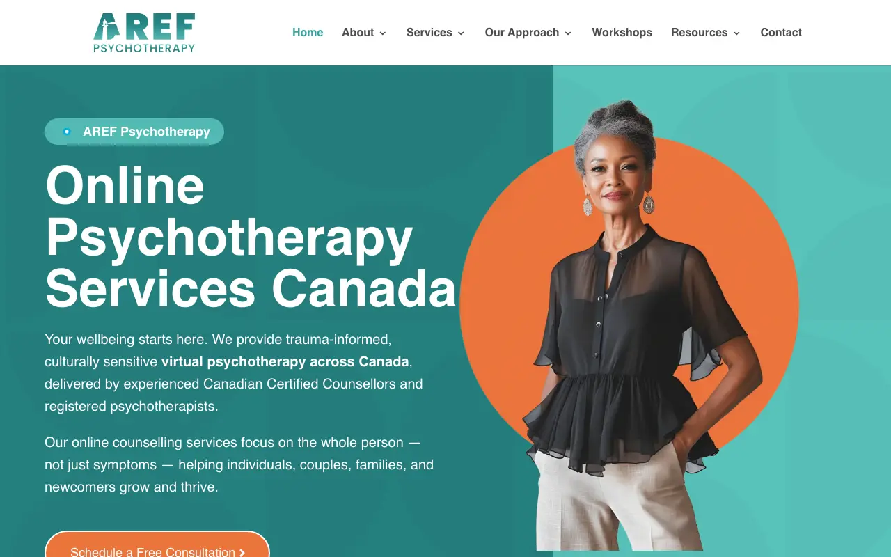

# 🔖 AREF Psychotherapy

**Take one thing.** The template most therapy sites are built from, done competently. It shows
what patients are used to, and how a credential can be shown without bragging.

| Site | Fonts | Colours |
| --- | --- | --- |
| [arefpsychotherapy.com](https://arefpsychotherapy.com) | Manrope 400–700 | White, `#F0F0F0`, teal `#25807E`, orange `#EB753B`, deep teal `#0B3D3B` |

AREF is a Canadian online psychotherapy clinic, sourced from its Awwwards profile rather than a
jury pick, and it is here as the baseline. Teal hero, a stock portrait in an orange circle, "Online
Psychotherapy Services Canada" in Manrope 600 at 74 px, a "Schedule a Free Consultation" pill, then
four icon cards, a "Who We Are" block, seven service cards, language chips, a logo strip, reviews,
a blog carousel and a closing call. Every section starts with a pill-shaped eyebrow label.

Two things in it are worth keeping. The logo strip is the college and association registrations,
which is how a patient checks a therapist is real; it's proof, not decoration. And "Available in
15+ languages" set as a row of language names in their own scripts says something concrete about
who is welcome.

The rest is the category default, and it shows why a visitor can't tell one practice from another.
Eleven sizes, four calls to action on the first two screens, icon cards for "Client First" and "We
Understand You", an eyebrow over every heading, and a stock model standing in for the clinicians.
"Finding the right therapist shouldn't come down to luck" is a good line lost in the middle of it.

**Take:** registration bodies shown as proof; languages listed by name. **Leave:** eyebrow labels,
icon cards, stock portraits and a call to action on every screen.
