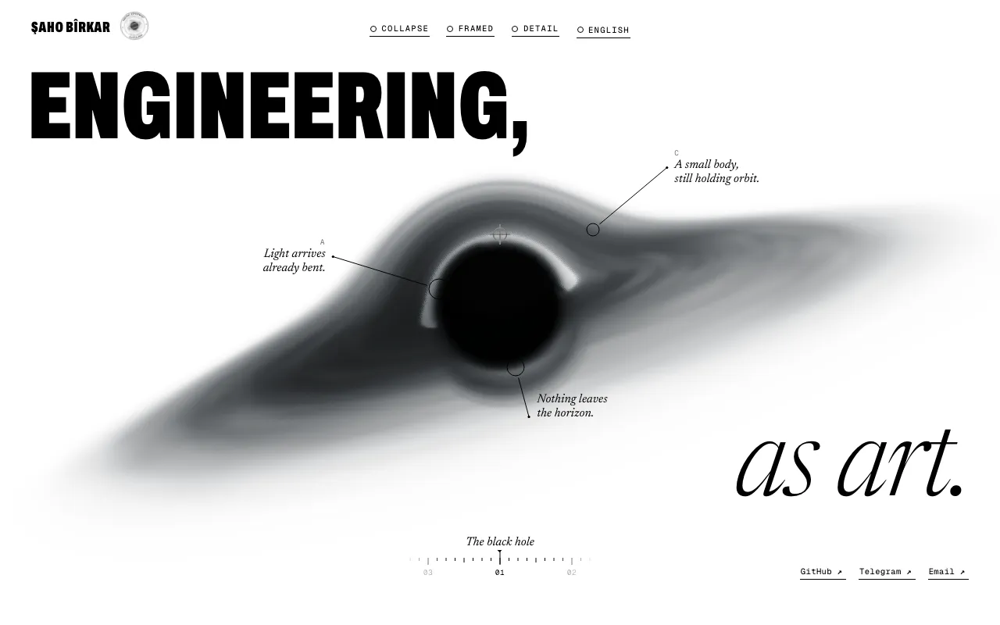

# 🔖 birkar.me

**Take one thing.** A figure annotated like a scientific plate, and case pages set as magazine
spreads. The front waits on an intro first.

| Site | Fonts | Colours |
| --- | --- | --- |
| [birkar.me](https://birkar.me/) | Archivo Cast, Newsreader, Geist, Geist Mono | White, black, greys |

An engineer's portfolio that sets out to look like a physics journal. The first screen is a
blurred sentence, "My name is ŞAHO BÎRKAR; and I'm an ENGINEER.", that comes into focus over a
ruler while a mono counter compiles. After that comes "ENGINEERING, as art." around a rendered
black hole, with italic serif notes on leader lines: "Light arrives already bent."

The pairing is the lesson. Condensed bold caps (Archivo) for names, a light italic serif
(Newsreader Display) for the standfirst, a book serif for body and mono for meta. On the case
pages ("EVÎN", "WORMHOLEKERNEL") that becomes a spread: a black title block, an italic standfirst
("Music, with love."), body in a boxed column, a pronunciation guide. Annotating a figure with
short notes on leader lines explains a diagram without a legend.

It's too much. The page uses 23 sizes, from 133 px down to 9 px. The intro makes a reader wait
about six seconds before anything is legible, and the site is 31,000 px long.

**Take:** a diagram explained by notes on leader lines; condensed caps plus italic serif plus mono
as three clear voices; a standfirst on each case. **Leave:** a focus intro; 23 sizes; 9 px labels.
