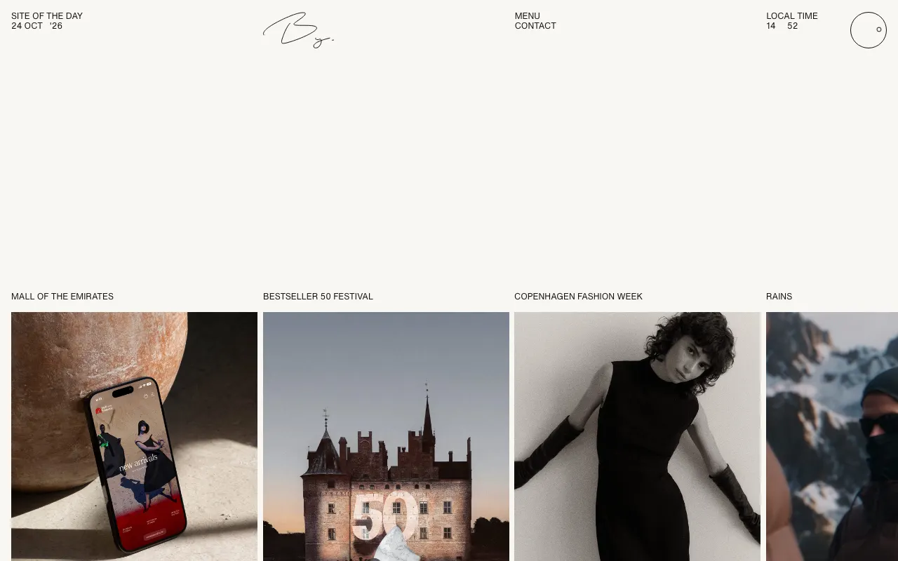

# 🔖 brandonyasin.com

**Take one thing.** The cleanest case-study pages in the set, behind a home page that says nothing.

| Site | Fonts | Colours |
| --- | --- | --- |
| [brandonyasin.com](https://brandonyasin.com/) | Helvetica Now, Neue Haas Unica | `#f8f6f2`, `#111`; colour comes from the photos |

Editorial restraint at its purest. Off-white paper (`#f8f6f2`), near-black type, two type sizes on
the home page, a handwritten signature and four photographs. Every bit of colour comes from the
work. The message is that his taste is the product, and he won't decorate around it.

The case pages are magazine spreads. A lowercase title in a large grotesk sits bottom-left. Two
tiny caps columns give the client and year, then the discipline. One paragraph, then rows of
art-directed images. Nothing explains the images; the paragraph says what the job was and the
pictures prove it. It's the cleanest case-study anatomy in this set.

The home page tells you nothing but his name, which only works if visitors arrive from an award
gallery already curious. On a phone the four-image strip becomes a sideways scroll that hides most
of the work. And the whole approach depends on having photography this good. With ordinary
screenshots it would look empty, not restrained.

**Take:** let the work carry all the colour; case pages as title, two meta columns, one paragraph,
images. **Leave:** a home page with no words, unless the visitor already knows you.
