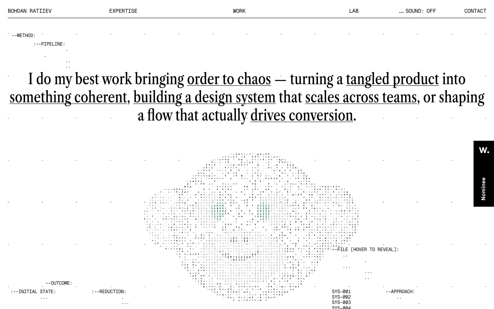

# 🔖 bratiiev.com

**Take one thing.** Two good ideas inside a fashionable costume.

| Site | Fonts | Colours |
| --- | --- | --- |
| [bratiiev.com](https://www.bratiiev.com/) | Libre Caslon, Geist Mono | Black, white, mint `#a9edc6` |

A product designer's portfolio built from the ingredients of the 2025–26 "designer who codes" look:
a book serif (Libre Caslon), monospace annotations drawn like a terminal tree (`--METHOD:
--PIPELINE`), a dotted grid, a dot-matrix face, one mint highlight. That combination is everywhere
on award sites right now, and the risk is that it's a costume. Bratiiev mostly gets away with it,
because the annotations do real work.

The serif statement is the claim: "I do my best work bringing order to chaos…". The mono notes
around it read like comments in code: method, initial state, outcome. So the page speaks in two
voices, the polished pitch and the engineer's margin notes, and that's the best idea here. The
archive at `/work` is the other strong piece. Projects are numbered `/001` to `/010`, each with a
year, a sector and one line, and no thumbnails. It reads like a ledger and makes you read.

A lot of it is affectation, though. There's a sound toggle, a "Speculative Lab" of blurred
thumbnails that show nothing, and a faded band of buzzwords crawling across the page
("Architecture :: Metrics :: Design System :: AI"). Labels sit at 33% opacity, decorative rather
than legible. At phone width the mono annotations turn into noise around the statement instead of
supporting it.

**Take:** two voices, a serif claim annotated in mono; an archive as numbered rows with no images.
**Leave:** mono used as texture rather than information; buzzword bands; anything that needs
sound.
