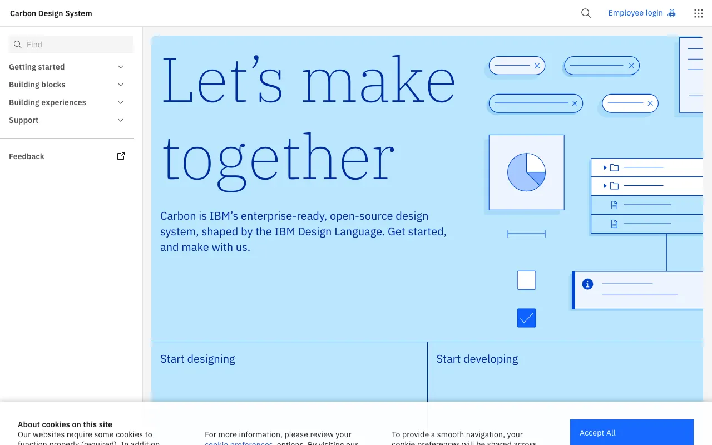

# 🔖 Carbon

**Strong reference.** The most opinionated design-system site: square, thin and engineered.

| Site | Fonts | Colours |
| --- | --- | --- |
| [carbondesignsystem.com](https://carbondesignsystem.com) | IBM Plex Serif, Plex Sans, Plex Mono | `#f4f4f4`, ink `#161616`, blue `#0f62fe` |

IBM's design system has more personality than any other design-system site I looked at, and it
gets there by refusing to be friendly. The hero is "Let's make together" in IBM Plex Serif at
weight 200, huge and thin, on a flat light-blue panel. That's the opposite of the bold-sans hero
everyone else uses. Every corner is square and every tile is separated by a one-pixel line. It
looks engineered, like an IBM manual from the seventies, and doesn't apologise for being a tool
for enterprises.

Plex is the quiet win. Serif, sans and mono come from one superfamily, so the three voices agree
with each other without any effort. It's the easiest way I've seen to get a coherent three-face
system. The data-visualisation overview is the other highlight: every chart type appears as a
small thumbnail, grouped by what it's for (Simple, Flow, Spatial). A subject that's usually a wall
of text becomes something you browse with your eyes. The data table page numbers the parts of the
component on a diagram, the way a product manual would.

The cracks are practical. A cookie banner covers the first screen. In the full-page capture the
home page has long blank stretches, probably illustrations that load lazily, so the page feels
unfinished until they arrive. The blue line illustrations are pleasant corporate filler, nothing
more.

**Take:** square corners and hairlines as a whole attitude; one superfamily for three voices;
browse-by-thumbnail for a catalogue of charts. **Leave:** decorative corporate illustration.
