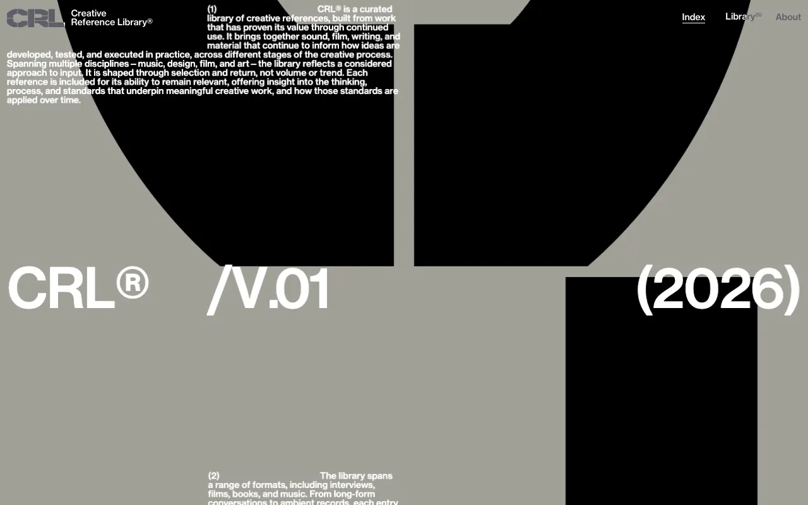

# 🔖 Creative Reference Library

**Take one thing.** Counts and two views are worth taking; the Swiss styling overreaches.

| Site | Fonts | Colours |
| --- | --- | --- |
| [crl-2026.webflow.io](https://crl-2026.webflow.io/) | Neue Haas Grotesk | Grey `#a1a098`, black, white |

A curated library of interviews, books and films that behaves like a printed catalogue. It has a
giant black glyph cropped off the canvas, Neue Haas Grotesk on warm grey paper (`#a1a098`), and
numbered sections. It's Swiss revival, done with conviction.

Its best idea is small: counts in parentheses everywhere. "Creatives whose work shapes the CRL
(20)", "(2) Books", "(4) Albums", "(9) Videos". Before you click, you know how big each collection
is, which is exactly what an index is for and almost no site bothers to do. The library also
switches between a Wheel view and a List view, so the same collection has two temperaments: one
for wandering, one for finding.

It overreaches in the usual Swiss-revival ways. Body text is set directly over the glyph, which is
unreadable on a phone. Some labels are 8 px. The first screen says "CRL® /V.01 (2026)", which is
styling rather than information. And the tilted polaroid portraits in the library feel like a
scrapbook, at odds with the rigour of everything around them.

**Take:** a count beside every category; two views of one collection. **Leave:** text over
graphics; labels too small to read.
