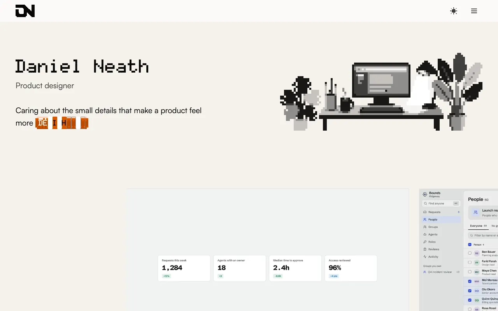

# 🔖 danielneath.com

**Strong reference.** A product designer who shows real product screens and titles each case by
what changed, not by the client's name.

| Site | Fonts | Colours |
| --- | --- | --- |
| [danielneath.com](https://danielneath.com/) | Satoshi, Doto, Anonymous Pro | Warm paper `oklch(0.962 0.007 81)`, ink `oklch(0.13)`, one orange |

The front page is a strip of cases, and each one is the same four things: a real screen from the
product, a 32 px title, a paragraph and a role line. The title is the move. "A 3-hour training
setup became one bulk assignment" and "Connecting an AI tool went from 19 steps to one screen" are
outcomes, so a reader learns what the work did before they learn who it was for.

The type system is small and disciplined: Satoshi for reading at 16 and 20 px, a pixel face (Doto)
only for the name, Anonymous Pro for dates and labels. That makes eight sizes on the front page.
The warm off-white paper is close to a terracotta-and-cream identity without being beige, because
the orange is spent only on one highlighted word and the email button. The About page sets the CV
as dated rows, with a mono year column and a role-plus-paragraph column, which reads faster than
any timeline graphic.

It slips where it plays. The About page drops a pile of physics-driven tags ("UX/UI", "SHIP",
"BRAND") over the bio, so the text sits under confetti for the first seconds. The Craft page is a
pannable canvas of experiments that is fun once and hard to scan. The front strip scrolls sideways
on desktop, so the fourth case is easy to miss.

**Take:** case titles written as outcomes; a CV as dated rows; one accent spent on one word.
**Leave:** tags falling over the text; a canvas where a list would do.
