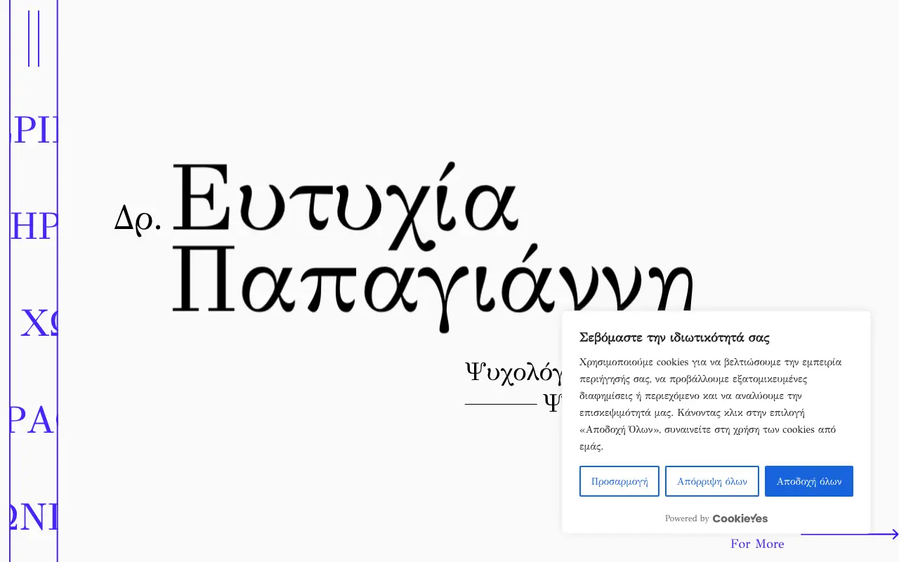

# 🔖 Dr. Eftychia Papagianni

**Take one thing.** A solo psychologist's site with one face and one colour, and sessions described
as plain facts. Its navigation is a typographic experiment patients have to decode.

| Site | Fonts | Colours |
| --- | --- | --- |
| [eftychiapapagianni.gr](https://www.eftychiapapagianni.gr) | GFS Didot 400 | White `#FAFAFA`, black ink, violet `#4527FD` |

Dr. Papagianni (Awwwards honourable mention, 2023) is a psychoanalytic psychologist in Greece, the
only solo European practitioner in the set whose site still works well. Everything is GFS Didot, a
Greek Didone, at 18 px for text and 54 px for her name, with one electric violet for the rules and
links. It feels personal and literate, like a letterhead.

The services page is the part to study. Each service is a heading, a label–value line ("Session
length: 45' — individual sessions are for adults") and a paragraph on how the sessions run. A
patient learns the format, the length and who it's for without reading a sales pitch. Contact is
the same: facts first.

The navigation undoes it. Section names are set in violet capitals so large they're cropped by a
narrow left rail, so "ΠΕ", "ΥΠ" and "ΟΓΙ" are what a visitor sees. The home page scrolls
sideways, a cookie dialog covers the first screen, and labels drop to 11 px. It's the clearest case
in the set of a design made to be admired by designers rather than used by patients.

**Take:** one face and one colour for a solo practice; each service as facts (length, format, who
for) then prose. **Leave:** cropped display navigation, sideways scrolling.
