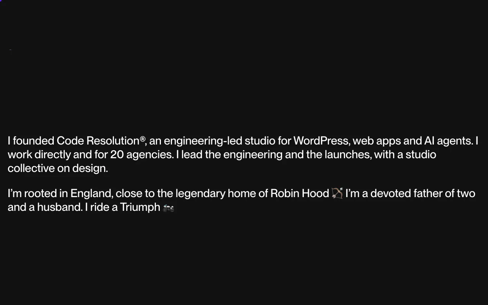

# 🔖 elliott.mangham.dev

**Take one thing.** A technical director's one-screen site, where the credentials are a strip of
facts and the pitch is two plain paragraphs.

| Site | Fonts | Colours |
| --- | --- | --- |
| [elliott.mangham.dev](https://elliott.mangham.dev/) | Roobert Mono, Neue Montreal | `#121212`, white at 100, 80 and 40% |

The page is two sizes: 11 px Roobert Mono for everything factual and 30 px Neue Montreal for the
two paragraphs that say who he is. The facts sit in six columns across the top (studio, years,
awards, clients, contact, booking), and the statement takes the middle of the screen. Then comes a
reel of project images. It reads like a business card set by someone who writes code.

The best detail is a caveat printed next to the numbers: "Figures describe our clients, not value
created. Nov 2025." A figure with its source and date beside it is rare on a portfolio and makes
every other claim on the page more believable. The statement is in the first person and specific
("I lead the engineering and the launches"), with no adjectives about passion.

Under that, the craft is thin. The mono strip is 11 px and the secondary facts drop to 40% white,
which is decoration rather than text. The project reel has no labels, so the work can't be named
without hovering. Emoji inside the statement undercut the plain voice it sets up.

**Take:** a figure printed with its date and what it does and doesn't measure; a first-person
statement with no adjectives. **Leave:** 11 px facts at 40% opacity; unlabelled work.
