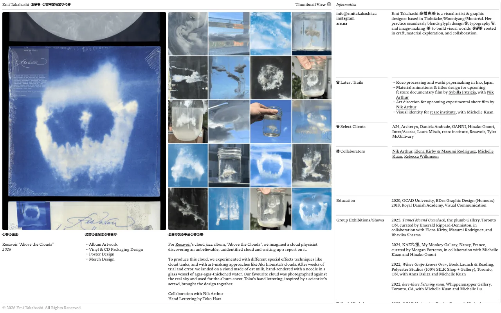

# 🔖 emitakahashi.ca

**Take one thing.** The CV stays pinned beside the work, so a reader never has to leave a project
to learn who made it.

| Site | Fonts | Colours |
| --- | --- | --- |
| [emitakahashi.ca](https://emitakahashi.ca/) | Marist, Galaxy Flower, Monument Grotesk Mono | White, black at 85% |

The page splits in two. On the left, projects scroll as image pairs with a caption set as a small
table: title and year, a list of disciplines, then a paragraph. On the right a fixed column holds
the whole CV: bio, latest work, clients, collaborators, education, exhibitions. It's the layout of
an exhibition catalogue, and it suits an artist whose work crosses print, animation and
installation.

Everything is one serif, Marist, at 10 to 12 px. At that size the serif reads like a footnote, which
is the intended register. The captions are the strong part: a project gets a fixed anatomy, so the
eye learns where the year and the disciplines are after one project.

The desktop text is too small to read for long. 8,200 characters at 11 px is a lot of squinting.
At 390 px the site gives up on the split and sets everything at 16 px in one column, which works
better than the desktop.

**Take:** a fixed caption anatomy repeated for every project; context that stays in view while work
scrolls. **Leave:** 11 px body text.
