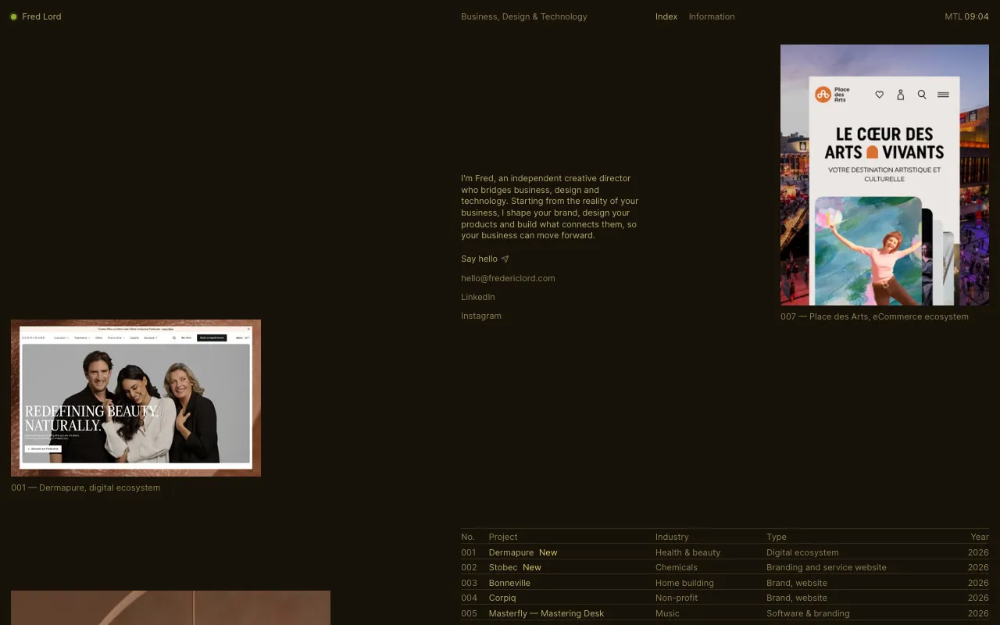

# 🔖 fredericlord.com

**Take one thing.** Fifty projects as one table, on a warm dark paper that isn't black.

| Site | Fonts | Colours |
| --- | --- | --- |
| [fredericlord.com](https://fredericlord.com/) | Inter | `#171209` paper, olive `#8c7f54` and `#b5a96f` ink, `#dfc767` highlight |

A creative director's site set entirely in Inter at 11 px. Hierarchy comes only from position and
two inks. The index is the page: every project numbered `001` to `050`, with industry, type and
year in columns. Recognition is two more columns, and the approach is three short paragraphs set
at staggered positions across the grid. A few selected screenshots float near the top.

The palette is what's worth studying. The paper is a brown-black, the ink is olive and khaki, and
the one highlight is a dull gold. It feels like a printed annual report on dark stock, not a dark
mode, and it proves a warm dark theme can carry a whole site without a single pure black or white.

One size for everything is a stance that costs the reader. Headings don't exist, so the approach
text and the table header look the same. At 11 px the olive ink on brown is legible but tiring.

**Take:** the whole archive as one numbered table; a warm dark palette built from one hue family.
**Leave:** one 11 px size for every role.
