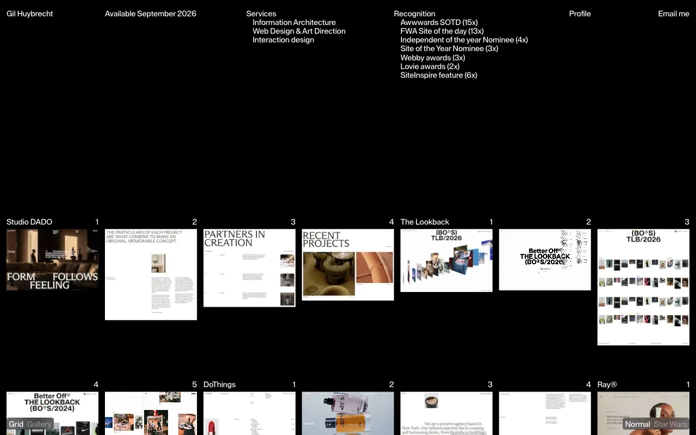

# 🔖 gilhuybrecht.com

**Take one thing.** Each project is shown as the row of pages it really shipped, not as one hero
shot.

| Site | Fonts | Colours |
| --- | --- | --- |
| [gilhuybrecht.com](https://gilhuybrecht.com/) | One sans, 500 | Black, white, white at 40% |

The header is six columns of facts: name, availability, services, recognition, profile, email.
Recognition is counted ("Awwwards SOTD (15x)", "FWA (13x)"), which says more than a logo wall. The
whole site is one size, 15 px, one weight.

The work is the idea. A project is a row of four or five screenshots of its actual pages, numbered
1 to 5 within the project, with the project name above the first. A reader sees the home page, an
article, a listing and a detail page side by side, so the system is visible, not just the hero.
Hovering one project dims the others.

The single size makes it hard to find where one project ends. A "Star Wars" view toggle is a joke
that sits in the same place as the useful Grid and Gallery switch.

**Take:** a project as the sequence of its real pages; credentials as counts. **Leave:** one size
for names and body alike; joke toggles beside real controls.
