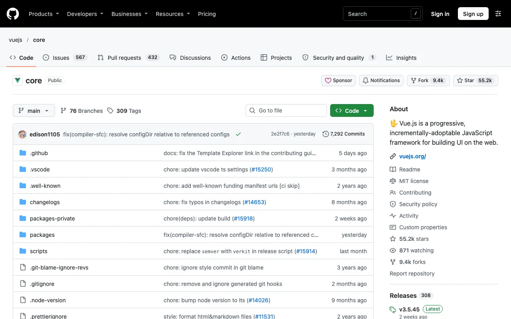

# 🔖 GitHub repository

**Take one thing.** The repository page is the reference shape for a project detail page; the
Insights and Projects pages around it are weaker.

| Site | Fonts | Colours |
| --- | --- | --- |
| [github.com/vuejs/core](https://github.com/vuejs/core) | Mona Sans; 7 sizes, 12–32 px; `ui-monospace` in code | White, `#f6f8fa`, ink `#1f2328`, muted `#59636e`, blue `#0969da` |

Every developer has read a thousand of these pages, which is the point. The repository page is a
two-column detail page: tabs with counts across the top (Issues `567`, Pull requests `432`), the
working content on the left, and an About sidebar of facts on the right. That sidebar is the quiet
success. Stars, forks, licence, latest release and a single stacked language bar (TypeScript 97.1%)
are a column of label-and-value lines, not a grid of stat cards. It holds a dozen facts in less
space than three tiles would.

The README sits in its own boxed panel with a tab bar of its own (README · Contributing · MIT
licence · Security) and an outline button that opens its headings. The prose inside is 16 px against
14 px for the rest of the page, with ruled `h2`s, so the document reads as a document inside an app,
not as more app. At 390 px the About sidebar moves above the file list, the commit-message column is
dropped and the overflow tabs fold into "More". It's the same page, reordered by importance.

The pages around it are less disciplined. Pulse opens well, with two split bars (merged against open
pull requests, closed against new issues) over a four-cell stat strip. Then it turns into a prose
summary ("9 authors have pushed 11 commits") and several screens of event lists.
Contributors puts a range brush under its weekly bar chart, which is useful, then small multiples
per person. The public roadmap board is a pill swamp: every card carries four to six coloured
labels, so nothing on a card stands out.

**Take:** facts as a label-value sidebar beside the main content; the README boxed with its own tabs
and outline; counts inside tabs; reflowing by importance on phones. **Leave:** prose summaries of
numbers already shown; cards carrying more than one or two coloured labels.
