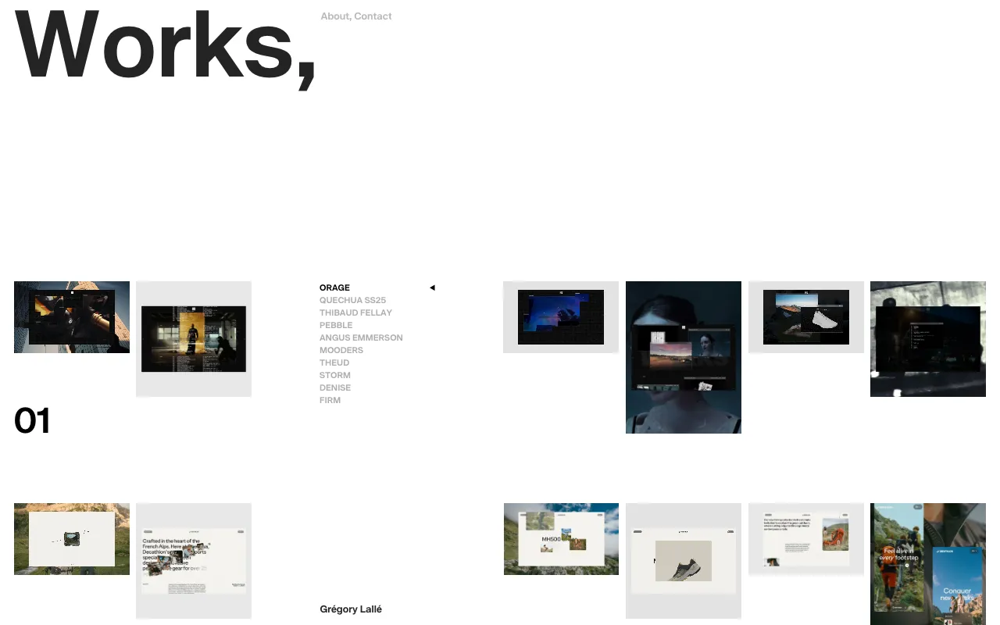

# 🔖 gregorylalle.com

**Take one thing.** A short index of project names stays fixed on screen and marks the one you're
looking at.

| Site | Fonts | Colours |
| --- | --- | --- |
| [gregorylalle.com](https://gregorylalle.com/) | NG, a grotesk at 500 and 600 | White, black, `#242424` |

"Works," sits at 117 px in the top left and never moves, comma included, as if the page were the
rest of the sentence. Under it, a centred list of ten project names in 11 px stays put while the
screenshots scroll past, and an arrow moves down the list to show which project is in view. Each
project gets a 44 px number and a loose cluster of screens on a six-column grid.

Four sizes do the whole site, and the jump from 117 to 44 to 12 is wide enough that each one has a
single job. The fixed index is the best wayfinding device in this set: a table of contents that is
also a progress bar.

The images carry no captions, so a project is only its number until you find its name in the
index. The index itself is 11 px. At 390 px the title grows to 132 px and the index disappears,
which removes the only way to know where you are.

**Take:** a fixed table of contents that marks the current section; three sizes with wide gaps.
**Leave:** unnamed images; an 11 px index.
