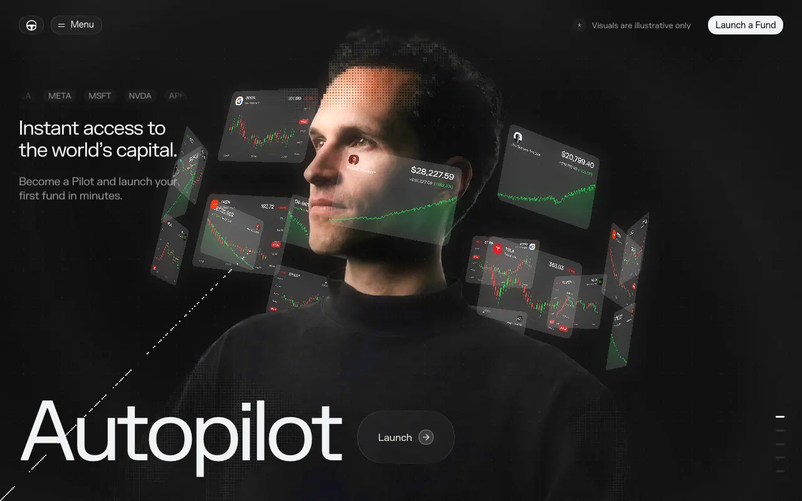

# 🔖 Autopilot

**Take one thing.** A three-step product story told as one continuous scroll film, and done well;
the cost is 17,600 px of scrolling and earnings claims the page itself calls illustrative.

| Site | Fonts | Colours |
| --- | --- | --- |
| [launch.joinautopilot.com](https://launch.joinautopilot.com/) | FK Grotesk | Near-black, white, translucent greys; colour comes from the footage |

A launch page for a product that lets people publish an investing strategy as a fund others copy.
It explains that in three steps, and it doesn't use three sections to do it. It uses one scroll
that plays like a short film: a portrait surrounded by floating trading charts, then a hand
holding the app ("Pick your stocks", "Users invest"), then the same man driving through mountains
("Monetize your strategy"). The product is called Autopilot, so the last act is a car. The
metaphor is obvious, but it's carried all the way through instead of being stated once in a
headline.

The craft is in the transitions. Each scene dissolves into the next through a coarse pixel
dither, so the photo breaks into dots and re-forms as the next shot. It's one recognisable move
used every time, which makes the whole page feel like a single piece rather than a stack of
sections. The earnings arc in the last act grows as you scroll, from "~$100,000/yr with 800
subscribers" to "~$10,000,000/yr with 50,000". The number animates, and that's the right place to
spend motion. The step counter (01, 02, 03) and a sticky header with one "Launch a Fund" button
keep you oriented the whole way. On a phone the same story holds: text above, footage below, the
counter at the bottom.

The cost is length and honesty. Three ideas take about 17,600 px of scrolling, and between scenes
whole screens are black or half-loaded while the next shot arrives. The interface shown on the
floating cards is decoration, and a small "Visuals are illustrative only" note says so; the
$10M-a-year figure gets the same treatment. Body text is small grey on black, under display
type at 133 px. It's a page you watch, not one you read or scan.

**Take:** a short sequence of steps told as one continuous scroll, with a counter and a sticky
call to action; one transition used everywhere as the signature; motion spent on the number that
matters. **Leave:** the scroll length; imagery and figures labelled as not real.
