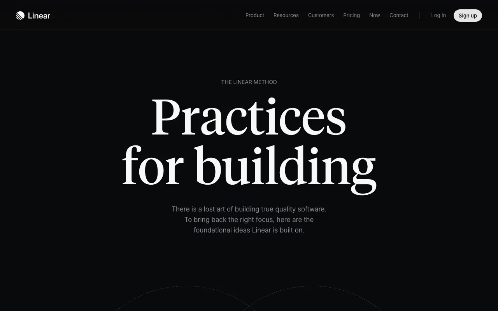

# 🔖 Linear Method

**Strong reference.** The model for a long document. Its dark grey-and-indigo palette now reads as a
template.

| Site | Fonts | Colours |
| --- | --- | --- |
| [linear.app/method](https://linear.app/method) | Tiempos Headline, Inter, Berkeley Mono | `#08090a`, `#f7f8f8`, grey `#8a8f98`, indigo `#5e6ad2` |

Linear's essay on how it builds software, set as a short book. The move that makes it work is the
serif. In a field where every product page is set in a geometric sans, "Practices for building"
in Tiempos Headline at 128 px says *this is a text to be read, not a pitch*. The contents page backs
that up: chapters grouped under small caps labels and numbered 1.1 to 3.6 in Berkeley Mono, so it
feels like something you could cite by section. The only illustration is a faint line-drawn Venn
diagram, closer to a wink than a feature.

The chapter pages are the best long-form reading on a dark background in this set. There's one
column of about 600 px, a 72 px serif title, short sans subheads, and generous air between each
principle. No sidebar, no table of contents chasing you down the page. It trusts the reader to
read, which is the right call for a document meant to be read top to bottom.

The problem is everything around the serif. Near-black paper, grey body text (`#8a8f98`), Inter,
one indigo accent: that's the default look of every developer tool since about 2021, and of the AI
products that copied Linear after. At a glance it reads as generic, and you only notice the craft
once you start reading. The grey body passes contrast at about 6:1 but gets tiring over a long
chapter. And the product's full sitemap footer arrives at the end of every page, breaking the
book feeling just as you finish a section.

**Take:** a serif display, a sans for reading and a mono for numbers, each with one job; a numbered
table of contents as the front door to a long document; one reading column. **Leave:** the
dark-grey-plus-indigo palette, which now reads as a template.
