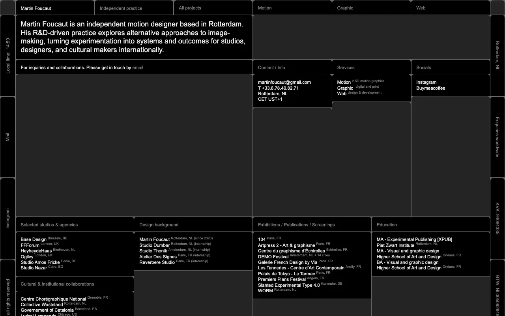

# 🔖 martinfoucaut.com

**Take one thing.** An idea, not a site: structure as the look, at a size nobody can read.

| Site | Fonts | Colours |
| --- | --- | --- |
| [martinfoucaut.com](https://www.martinfoucaut.com/) | Arial | `#242424`, `#696969`, text `#efefef` |

More an idea than a site. The entire portfolio is a spreadsheet: labelled cells, column headers
such as Client(s), Service(s), Year(s) and Credit(s), and rotated labels running down the margins
(local time, mail, Instagram). It throws out every portfolio convention, with no hero, no images
up front and no story, and reads like a CV someone poured into a data grid.

As a provocation it's useful. What if every block on a page were labelled the way a table labels
its columns? For a site full of records and metadata, that's a real question. Structure stops
being hidden scaffolding and becomes the look.

As a site it barely works. It's Arial at 9 to 11 px, grey on grey (`#696969` on `#242424`), and
most cells were empty in the capture, so presumably the work appears on hover or later. It's a mood
board for "structure as aesthetic", not something to copy.

**Take:** labels as structure. **Leave:** everything about the legibility.
