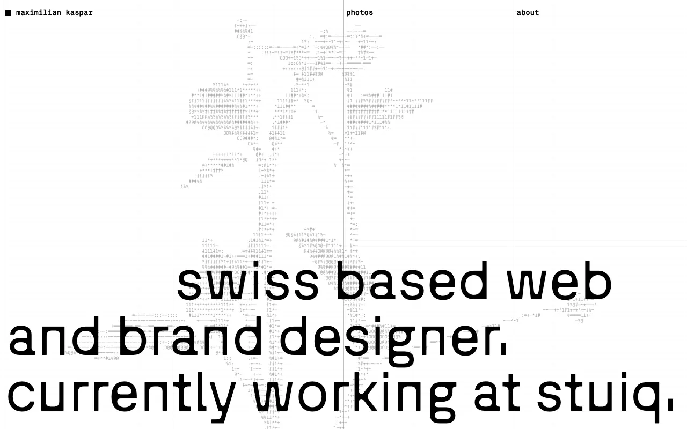

# 🔖 maximiliankaspar.com

**Take one thing.** The grid is drawn on the page, and every project's facts line up with it.

| Site | Fonts | Colours |
| --- | --- | --- |
| [maximiliankaspar.com](https://www.maximiliankaspar.com/) | Neue Montreal, Neue Montreal Mono, Bugrino | White, black, grey hairlines |

Four vertical hairlines run from the top of the page to the bottom, and everything sits between
them. The statement ("swiss based web and brand designer, currently working at stuiq.") is 102 px
of Bugrino. Each project then opens with one row across the four columns: name and a paragraph,
disciplines, year and credits. The images follow in the same columns.

Drawing the grid turns layout into content. A reader sees why a caption sits where it does, and the
project rows read like a spec sheet because the columns never move. The type is three faces at
three sizes (102, 14, 12), and the mono is used only for facts: disciplines, year, credits.

The ASCII plant fixed behind everything is the weak part. It sits under the statement and the
captions and lowers their contrast for no information. Captions as file names (`li_001.jpg`) are a
costume of rawness.

**Take:** visible column rules as the page's structure; a project's facts as one row on that grid.
**Leave:** an ASCII figure behind text; file names as captions.
