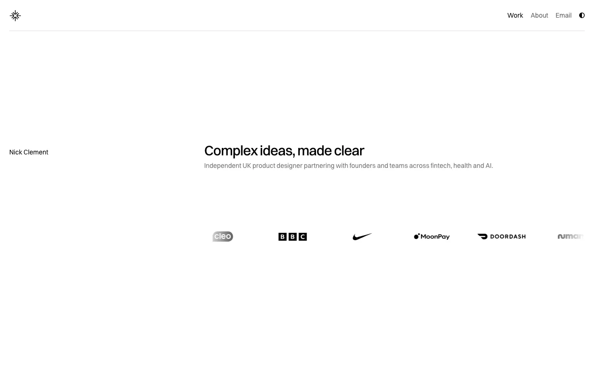

# 🔖 nickclement.com

**Strong reference.** One grammar for every page: a label column on the left, the content on the
right.

| Site | Fonts | Colours |
| --- | --- | --- |
| [nickclement.com](https://nickclement.com/) | Switzer, Geist Mono | White, greys `#404040`–`#707070`, black |

A product designer's site built for founders who skim. On the front, each project's caption sticks
on the left (name, a one-line pitch such as "Money talks. Cleo talks back.", a sentence, three
small tags) while its images scroll on the right. Side projects become index rows: name, one line,
year. The About page carries the same split through the whole page: About, Focus, Previously,
Recognition, Open to chats with, Connect, each a label with its content beside it.

The case page puts the facts down the left (Role, Studio/Client, Sector, Link) as label–value
lines, and two paragraphs of context on the right, before any image. One body size (14 px), one
heading size (30 px) and mono only for tags. It's the calmest way in this set to put a lot of
structured information on a page without a table.

The front page opens on a logo strip, the most template thing a portfolio can do. Most text is
mid-grey, `#707070` at 14 px, which passes AA by a hair. The tags are 9 px.

**Take:** label column and content column as the grammar for About and case pages; facts as
label–value lines before the story. **Leave:** a logo strip; grey body text at the contrast floor.
