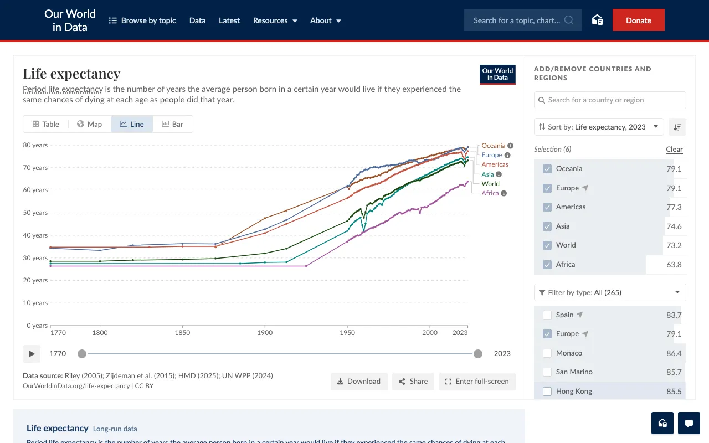

# 🔖 Our World in Data grapher

**Strong reference.** The chart page done properly: one dataset, four views of it, and its source
written under it.

| Site | Fonts | Colours |
| --- | --- | --- |
| [ourworldindata.org/grapher/life-expectancy](https://ourworldindata.org/grapher/life-expectancy) | Lato, Playfair Display, Menlo; 11 sizes | White, panels `#f0f4fa`, ink navy `#1d3d63`, header `#002147`, one red button |

Our World in Data publishes thousands of charts, and each one gets a page built from the same
parts. The chart sits in a panel with four tabs, Table · Map · Line · Bar, and they're four views of
one dataset, not four pages. The Table tab is the best of them: country, latest value, and a Trend
column of sparklines, so the table keeps the shape of the chart. Lines are labelled directly at
their ends (Oceania, Europe, Africa) instead of in a legend box, which Primer's chart rules also ask
for.

Provenance is a first-class part of the page. Under the chart is the data source and licence. Below
that sits a key-value block with Unit, Date range, Last updated, Next expected update and Managed
by, then three bullet-point findings, then a download panel with the CSV and JSON URLs. A reader can
tell how old the number is and where it came from without leaving the page. Beside the chart, the
entity picker is a sortable list with each value as a bar behind its row, the same device Plausible
uses for its panels.

The house style is the weak part. Playfair Display headings, navy and pale-blue panels and 11 type
sizes read as an academic publisher, and the topic pages around the grapher lean further into
editorial serif on cream. At 390 px the picker folds into an "Edit countries" button and the tabs
become icons, which works. The related-chart rows are cut off at the right edge with no sign that
they scroll.

**Take:** chart and table as tabs of one panel; a sparkline column in the table view; labels at line
ends; source, unit and "last updated" printed under every chart. **Leave:** the editorial serif and
cream; rows cut off at the edge on phones.
