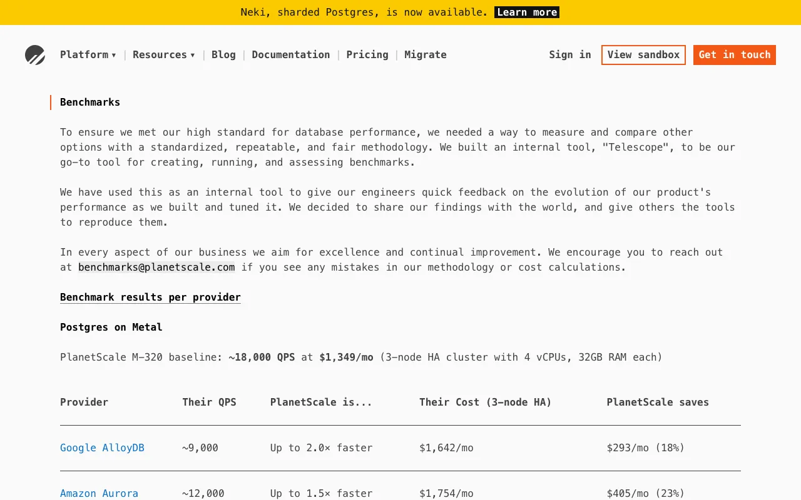

# 🔖 PlanetScale benchmarks

**Take one thing.** Charts written up like a lab report: each one followed by the sentence that
says what it shows.

| Site | Fonts | Colours |
| --- | --- | --- |
| [planetscale.com/benchmarks](https://planetscale.com/benchmarks) | `ui-monospace` only, one size: 16 px; Inter in the docs | Paper `#fafafa`, ink `#414141`, blue links `#0b6ec5`, yellow bar `#fbca00`, orange button `#f35815` |

PlanetScale set its whole marketing site in the system monospace at one size. Hierarchy comes only
from weight, underline and a short orange rule beside the page title. It's the boldest typographic
decision in the library, and on the benchmark pages it works. The pages read like a lab notebook:
the configuration as a ruled table (provider, region, vCPUs, RAM, storage, IOPS), the method in a
few bullets, then the results.

The charts are the lesson. Each one has its legend as a column of sparkline toggles beside it, so the
legend is also a preview of every series, and clicking one draws it in the main plot. Under every
chart is one sentence with the reading: "The PlanetScale database averaged ~18,000 QPS. Aurora
averaged ~12,000 QPS." A visitor never has to decode the plot to get the result, and someone who
wants to check can. A "Cost" section closes the page with the arithmetic written out inline,
`$516 × 3 + $209 = $1,754/mo`.

One size for everything stops working the moment the content isn't prose. Table headers and body
cells differ only by weight, and the monospace makes numbers align but also makes the paragraphs
wide and slow. At 390 px the configuration table silently drops its Storage and IOPS columns, and the
chart ticks shrink to about 6 px. The docs abandon the idea entirely for Inter on white in a stock
docs template, which suggests the team didn't trust mono for long reading either. Yellow, orange and
blue each do one job, but there are three of them.

**Take:** a one-sentence result under every chart; sparkline legends that double as series toggles;
the configuration as a ruled table before the results. **Leave:** a single type size; dropping
table columns on phones without saying so.
