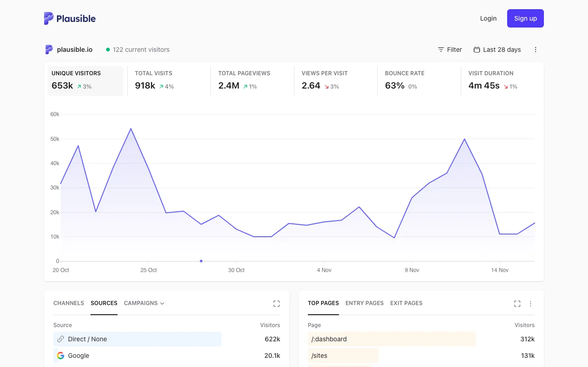

# 🔖 Plausible

**Strong reference.** The best one-page dashboard in the library: every panel is a short ranked list
that opens into the full table.

| Site | Fonts | Colours |
| --- | --- | --- |
| [plausible.io/plausible.io](https://plausible.io/plausible.io) | System sans only; 6 sizes, 12–36 px | Paper `#fafafa`, white panels, ink zinc `#27272a`, one indigo `#4f39f6` |

Plausible's live demo is its own analytics, shown to anyone. It doesn't try to be a configurable
cockpit. It's one fixed page: a strip of six stats, one chart, then five panels in a two-column
grid, all but the map a ranked list of nine rows. The opinion is that a small set of questions answered the
same way every time beats a canvas of widgets, and the page proves it. You know what the site's
traffic did this month before you've scrolled.

The stat strip is the clever part. It's not a row of tiles above the chart, it *is* the chart's
control: clicking "Total pageviews" swaps the series, and the selected stat gets a grey ground.
Figures are compact (`653k`, `2.4M`) with the exact count on hover (`2,415,142`). Each panel's
header holds its own tabs in 12 px uppercase (Channels · Sources · Campaigns), so five panels hold
seventeen views without a second page. Every row has a pale proportion bar behind its label, capped
at about 60% of the row, so the number column on the right never collides with it. An expand icon
opens the same list as a modal table with five more columns, sortable, and a "Press / to search"
filter. Nine rows to glance at, the full table one click away.

What doesn't hold up: each panel tints its bars a different pastel (blue, orange, green, red), which
is decoration, since the hue means nothing. Numbers aren't tabular or mono, so the right column
aligns by luck of the font. At 390 px the strip reflows to a 2×3 grid and the panels stack cleanly,
but long paths like `/:dashboard/custom-prop-values/url` break mid-word. The docs are a stock
Docusaurus site and teach nothing.

**Take:** stats that select what the chart shows; nine-row panels that expand to the full table;
panel-header tabs; bars behind labels that stop short of the figure. **Leave:** a different bar hue
per panel; proportional figures in a number column.
