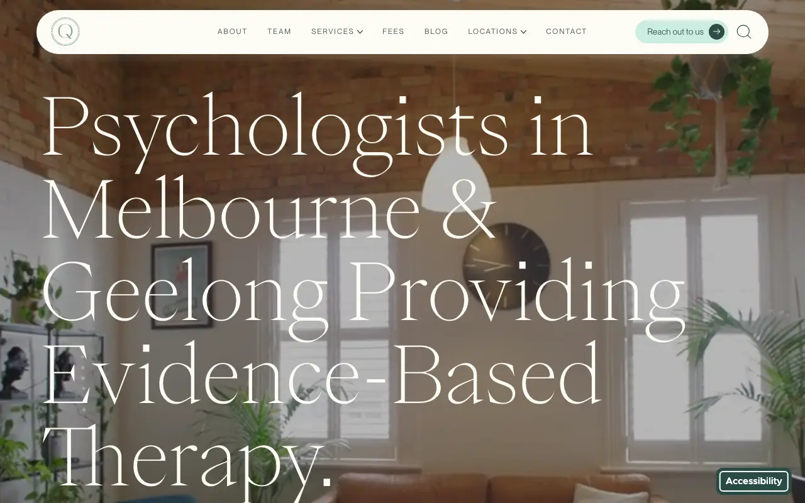

# 🔖 Q Psychology

**Strong reference.** A clinic site with the structure right everywhere below the hero: services as
ruled rows, clinics with addresses, and a contact page split between talking and writing.

| Site | Fonts | Colours |
| --- | --- | --- |
| [qpsychology.com.au](https://www.qpsychology.com.au) | PP Eiko 100, PP Neue Montreal 400–600 | Paper `#FDFBF5`, deep green `#2E4C47`, mint pills, black ink |

Q Psychology (Awwwards honourable mention, by Heads Under) is a team of psychologists across three
clinics in Melbourne and Geelong. The site reads as calm and competent, and most of that comes from
its structure rather than its look. Services are a list of names on hairlines with a small arrow,
not a grid of icon cards. The three clinics are listed with full street addresses and a "See
clinic" link. A team photo shows real people standing against a brick wall, not a stock model.

The contact page is the best in the set. On the left, a large "Get in touch", one sentence ("Simply
fill in the enquiry form or give us a call") and the email and phone written out in full. On the
right, a cream panel with an underlined-field form: name, email, phone, message. A crisis strip runs
the full width under the footer: "If you are in crisis: please contact Lifeline on 13 11 14".

The hero is the weak point. Its heading is an SEO sentence, "Psychologists in Melbourne & Geelong
Providing Evidence-Based Therapy.", set in PP Eiko at weight 100 and 125 px over a dark photograph.
Hairline strokes on a busy photo are hard to read, and five lines at that size push the actual
offer to the bottom of the screen. Fourteen type sizes, 12 px text in the pill buttons and a 15.7 px
body undo some of the calm.

**Take:** services as ruled rows; the split contact page with phone and email written out; real
addresses; the crisis strip. **Leave:** a hairline display face over photography and an SEO
sentence as the headline.
