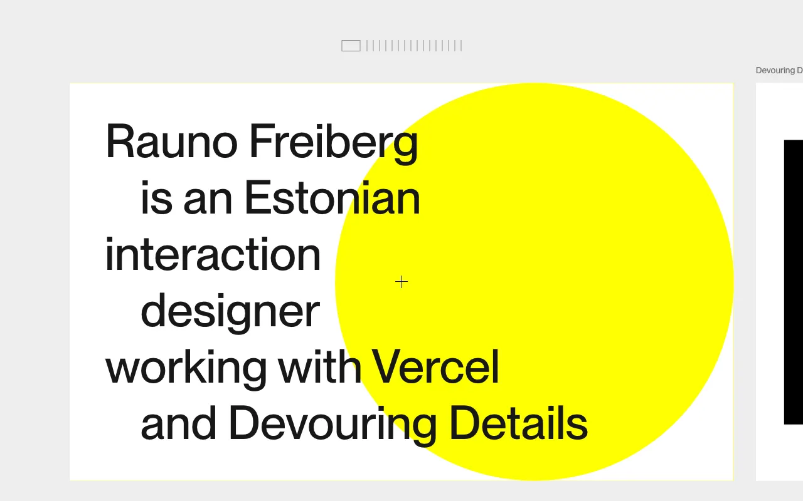

# 🔖 rauno.me

**Strong reference.** The best front page in the set: one sentence and total confidence. Hidden
navigation is its one flaw.

| Site | Fonts | Colours |
| --- | --- | --- |
| [rauno.me](https://rauno.me) | One custom face | White, yellow `#ffff02`, ink `#171717` |

Rauno Freiberg's portfolio shows how much confidence a site can carry with almost nothing on it.
The front page is one sentence and a yellow circle. There's no menu, no photo, no "selected work",
no client logos. The sentence does the job those usually split between them: an interaction
designer, from Estonia, working with Vercel and Devouring Details. Who, where and for whom, in
one sentence set at 85 px. The disc isn't decoration so much as the one loud thing on the page,
and its loudness is what makes the black type next to it look calm.

The site breaks with the vertical-scroll portfolio on purpose. It moves sideways through
full-screen panels, with a row of tick marks at the top as the only sign of where you are. That's
an interaction designer telling you what he does before you've seen any work. The work itself, on
`/craft`, is a wall of small experiments, and each one is a running clip rather than a screenshot.
For someone whose craft is behaviour, that's the honest medium: you see the thing move. `/projects`
is the opposite register, a plain list of title, year and a hairline. One page for browsing, one
for scanning.

The weakness is wayfinding. Nothing on the front page tells a first-time visitor that `/craft`
exists, and the tick bar is clever but doesn't read as navigation. It works because most people
arrive already knowing who Rauno is. An unknown designer copying this layout would lose people on
the first screen. The type is one custom face in four sizes, which is admirable restraint but not
something you can borrow. The palette, white with a highlighter yellow (`#ffff02`), isn't trying to
be tasteful. It's trying to be unmistakable, and it is.

**Take:** one sentence as the whole first screen; show behaviour moving, not described; a project
list that's just title and year. **Leave:** navigation only insiders can find.
