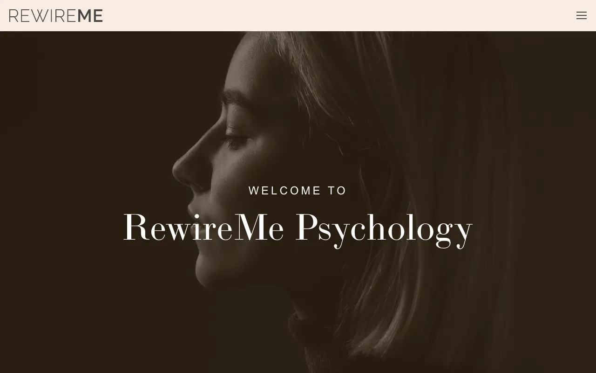

# 🔖 RewireMe Psychology

**Take one thing.** Shows the consulting rooms themselves, and explains the first step in three
lines. The moody portraits around them are mood board, not information.

| Site | Fonts | Colours |
| --- | --- | --- |
| [rewireme.com.au](https://rewireme.com.au) | LTC Bodoni 175, Arial | White, sepia `#3C2810`, grey `#434343` footer, blush `#F9ECE3` |

RewireMe is a Sydney psychology practice with two clinics, listed on Awwwards as an element by
Studio la Tas. The home page alternates full-bleed sepia portraits with short white sections. The
headline, in Bodoni at 36 px, is a good one: "Shape a mind that works *for* you, not against you".

What helps a visitor is in the white sections. "How We Help" is three numbered steps: begin
(book online, by phone or by email), meet your therapist, get expert support. Each step has a
button. The locations section shows each room as it actually is, with a pink sofa and a reading
chair, and "Take a tour" links per clinic. The professional affiliations (Medicare, AHPRA, APS) sit
near the end as a strip of real logos. "Psychology is for everyone… not about being screwed up" is
the same normalising move Self Space makes.

The portraits are the problem. Five anonymous faces in brown duotone take most of a 12,000 px
page, and none of them is a clinician, so they read as a fragrance campaign. The display face is a
high-contrast Bodoni, and the body falls back to Arial at 14–16 px with tracked capitals for
labels. The booking page is a third-party widget with a map, cut off from the site's look.

**Take:** photographs of the actual rooms; begin–meet–support as the first-step explainer;
registrations near the end. **Leave:** anonymous stock portraits as section dividers.
