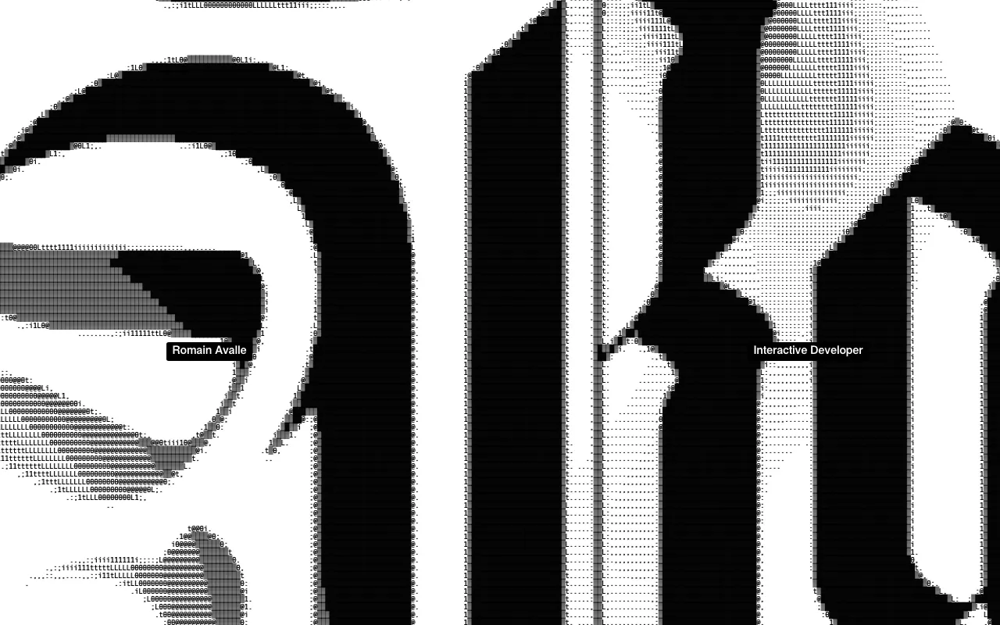

# 🔖 romainavalle.dev

**Take one thing.** The career as one table is the reference; the rest feels unfinished.

| Site | Fonts | Colours |
| --- | --- | --- |
| [romainavalle.dev](https://www.romainavalle.dev/) | Remus | Black and white only |

Radical reduction from someone who could show off. Romain Avalle has dozens of Awwwards and his
portfolio is, essentially, a list. There are three type sizes, black and white, one image and one
table. The statement is that the work is well known, so the list is enough. The one flourish is a
live ASCII render of a blackletter glyph behind his name, and it's thematically exact: a
developer's site whose only picture is made of characters.

The 39-row project table is the reason this site is in the library. Number, project, studio, role,
awards, year: a whole career scannable in one glance, oldest at the bottom like a CV. It's honest
in a way thumbnail grids aren't. You can see who he worked for, how often and how recently. On a
phone it drops everything but the project name. That's a reasonable fallback, but it loses the
career story, which was the point.

The execution is sloppier than the idea. The bio is written twice, two drafts stacked one after
the other. The meta columns are 11 px, too small to read comfortably. A large dead gap separates
the render from the bio, and it reads as a missing section rather than breathing room.

**Take:** a body of work as one numbered table; imagery made from the medium itself. **Leave:**
tiny meta type; unedited copy.
