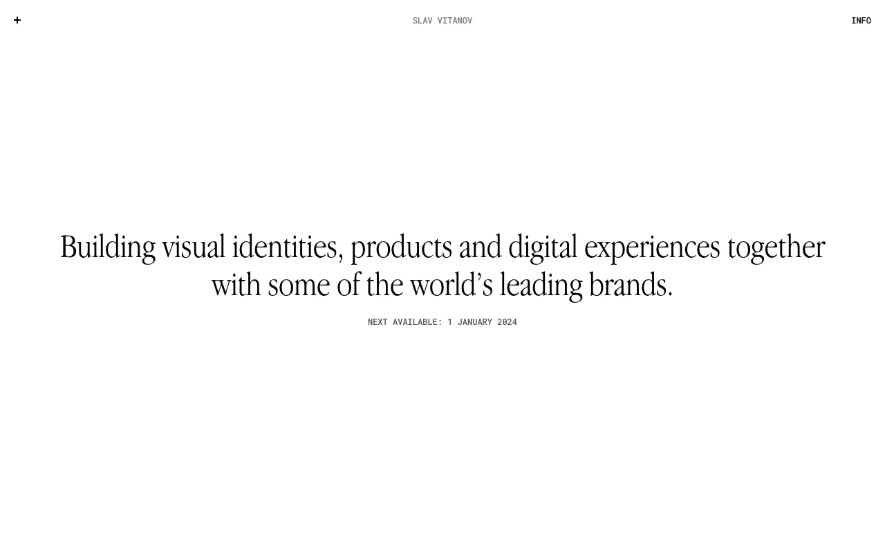

# 🔖 slavvitanov.com

**Strong reference.** Two voices and four sizes: every project is introduced by one serif sentence
and one line of facts.

| Site | Fonts | Colours |
| --- | --- | --- |
| [slavvitanov.com](https://slavvitanov.com/) | Apple Garamond Light, Roboto Mono | White, black, greys |

Almost every word on the site is either a light Garamond sentence or a line of mono caps. The
front page is one sentence. Each project gets a mono line with the client and the disciplines
("GOOGLE ARTS & CULTURE · ART DIRECTION, UI/UX DESIGN"), then one centred sentence saying what it
was, then a small boxed link, then the images. The Info page is the same: mono caps for BIO,
CLIENTS INCLUDE, AWARDS and CONTACT, a serif paragraph under each.

It works because the mono line carries data and never mood. The label above a heading here
isn't an eyebrow: it's the record of who and what, and the sentence below is the story. Four
sizes (50, 16, 12, 10) and two faces hold an entire portfolio. The light serif makes long project
sentences feel calm rather than loud.

The cracks are in the details. The home page says "Next available: 1 January 2024", the footer
says 1 September 2025, the phone view says 1 February 2026, and all three are past. The project
images sit in rounded panels that clash with the square type, and the 10 px mono is too small.

**Take:** one sentence per item, under a mono line of facts; two faces and four sizes for a whole
site. **Leave:** dates nobody updates; 10 px labels.
