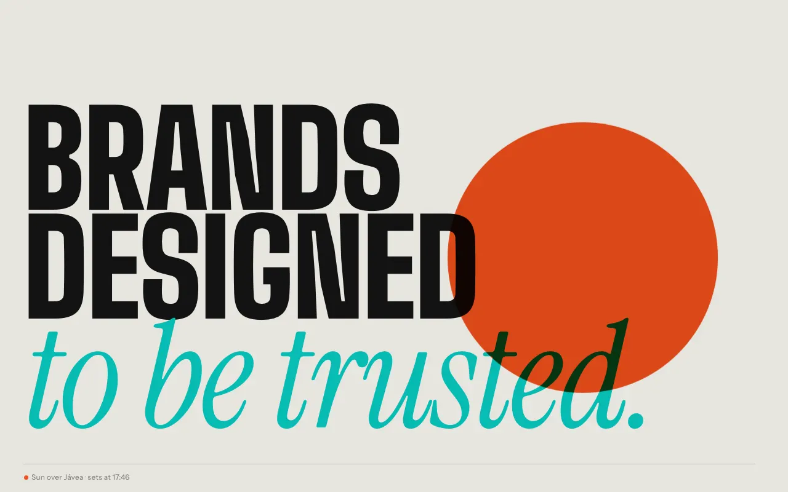

# 🔖 Super Eight

**Take one thing.** One good headline, then the agency template.

| Site | Fonts | Colours |
| --- | --- | --- |
| [supereightstudio.com](https://supereightstudio.com/) | Big Shoulders, Instrument Serif, Instrument Sans | `#f6f5f1`, orange, teal, deep green |

The first screen is genuinely strong. "BRANDS DESIGNED" in tall condensed caps (Big Shoulders)
crashes into "to be trusted." in a teal italic serif (Instrument Serif), beside a flat orange disc.
It's a confident pairing: loud and quiet, upright and slanted, in one headline.

Then it collapses into the agency template, section by section. A client-logo strip. A dark
rounded panel of client logos on gradients. Testimonial cards. A stats row, "17 / 150+ / 56+ /
12+". Team photos tinted teal. Journal cards. "Got a project? Let's roll." I measured 31 distinct
type sizes, which means there's no system below the hero, just whatever each section needed.

It's in the library as a reminder of how fast a good first screen gets drowned by the sections
every agency feels obliged to include.

**Take:** condensed caps against an italic serif as a headline move. **Leave:** everything below the
fold: logo strips, testimonial cards, stats rows, pills.
