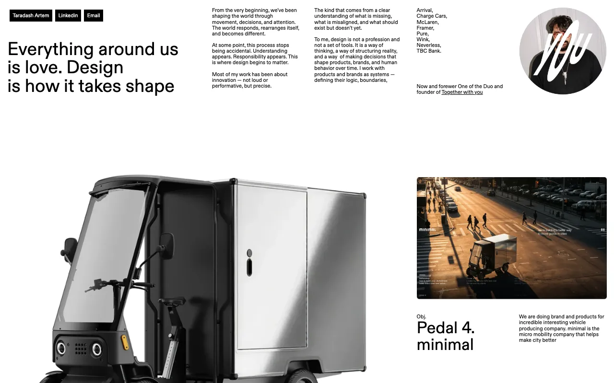

# 🔖 taradash.me

**Take one thing.** Text placed beside the image it describes, in narrow columns, like a printed
annual report.

| Site | Fonts | Colours |
| --- | --- | --- |
| [taradash.me](https://taradash.me/) | Explorer Diatype | White, black |

The front page is a short essay on design in three 11 px columns, next to a 35 px statement:
"Everything around us is love. Design is how it takes shape". The projects follow on the same
page: a 35 px title, the work, and each paragraph set in a narrow column right beside the picture
it explains. Nothing is captioned from far away.

That placement is the craft. A reader never has to match a paragraph to a picture three screens
up. The grid is Swiss and strict, with one face and four sizes, and the phone view rescues the
small text by raising it to 13 and 16 px.

At 1280 px, 7,800 characters of body at 11 px is too much to read. The statement is a motto that
says nothing about the work, and on the front page it competes with three columns of philosophy.

**Take:** text set beside what it describes, never far below it. **Leave:** 11 px long-form; a motto
in place of a claim.
