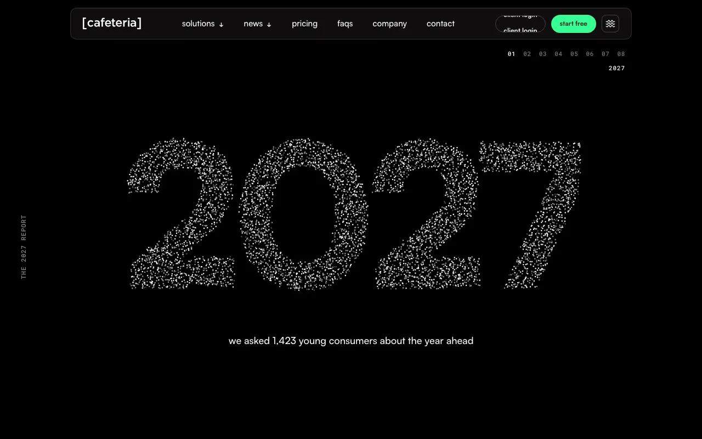

# 🔖 Cafeteria 2027

**Take one thing.** The plain text view is the lesson; the experience itself fails.

| Site | Fonts | Colours |
| --- | --- | --- |
| [teamcafeteria.com/2027](https://www.teamcafeteria.com/2027) | Satoshi, Roboto Mono | Black, `#f4f4f5`, one green |

A survey of 1,423 young consumers, told as an experience: "2027" in a shimmering dot-matrix,
optional sound, a chapter counter from 01 to 08. It's the kind of piece that wins awards. It's
also a black screen until you interact. On a phone, everything below the title stays black until
you start scrolling the story, and that failure defines it.

What saves it is the text view. One link away there's "2027 — a [cafeteria] report": the same
findings as numbered lists and quotes, each quote with a monospace line under it, `FEMALE · 17 ·
MIAMI`. Honestly, the text view is the better product. The data here *is* the voices, and voices
read best as a list of quotes with who said them. Having both is the lesson: the rich version for
the curious, the plain version for the reader who came for the facts, with the same content in
each.

The rest is standard startup marketing: black, near-white, one acid-green "start free" button,
fourteen type sizes.

**Take:** a plain text view one click from the rich one; a mono meta line under each quote.
**Leave:** content that waits for the reader to interact.
