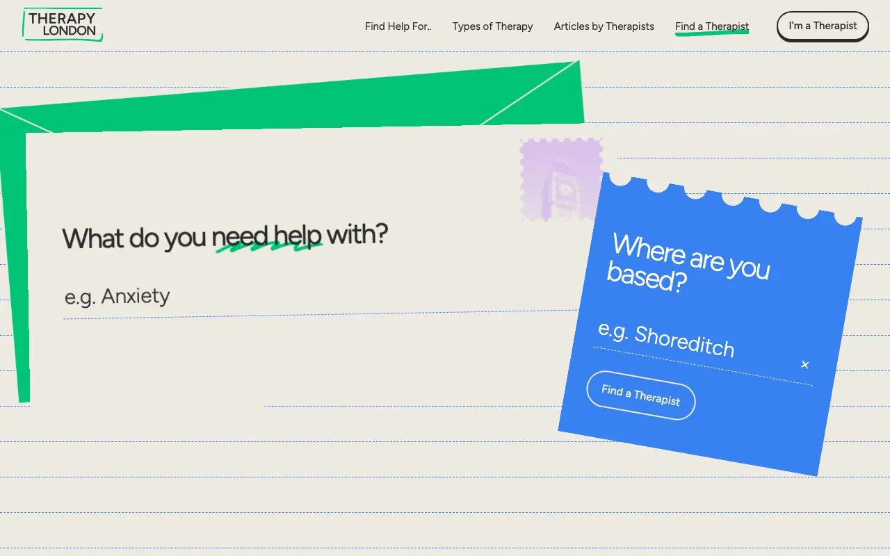

# 🔖 Therapy in London

**Take one thing.** It opens with the visitor's problem, "What do you need help with?", rather
than the practice's name. That one move is worth more than the rest of the page.

| Site | Fonts | Colours |
| --- | --- | --- |
| [therapyin.london](https://www.therapyin.london) | Figtree 200–600 | Paper `#EDEAE1`, ink `#2A2A2A`, blue `#3881F1`, green |

Therapy in London (Awwwards honourable mention, by Drool) is a directory of therapists, not a
practice, so its job is matching. Its first screen is an envelope with a field: "What do you need
help with? e.g. Anxiety", and a blue postcard asking where you're based. Below it, hand-drawn
furniture (an armchair, a sofa, a door ajar, a lamp) on warm grey paper gives the whole site the
feel of a living room rather than a clinic.

The idea to take is starting from the visitor's own words. Someone who arrives thinking "I can't
sleep" or "we argue all the time" sees their situation before they see anyone's credentials. The
"Find Help For" page continues it: an A–Z of concerns, each with a photo and one line. The three-step
"how to's of therapy" (search, see what they think, make contact) answers the process question in
three cards.

As a design it is busier than it looks. Ruled notebook lines run behind every section, the
practice's name is set again at 128 px under the search, and the illustrations change style from
section to section. Most of the page's machinery, the location field, the therapist sign-up and the
directory search, belongs to a marketplace a single clinician doesn't have.

**Take:** the first question is the visitor's problem in their own words; concerns as a list a
person can find themselves in; the first step explained in three parts. **Leave:** notebook-paper
texture, mixed illustration styles, directory mechanics.
