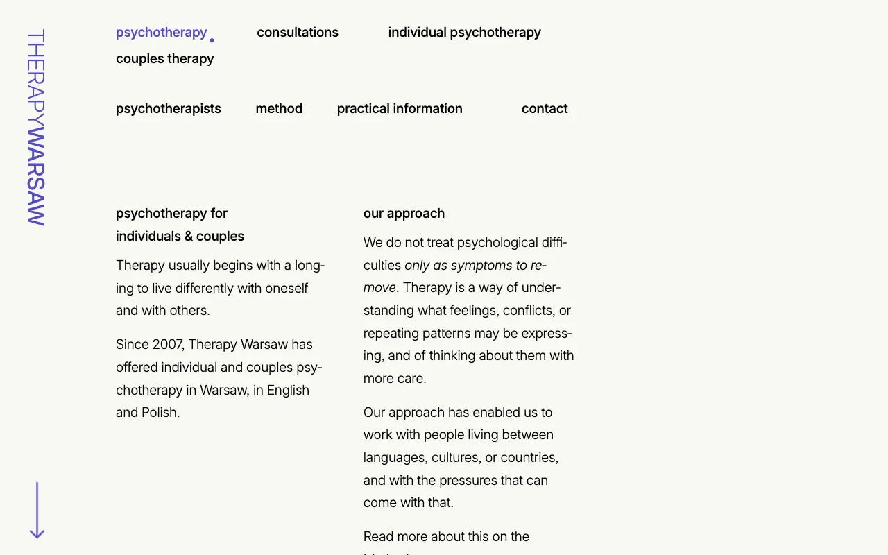

# 🔖 Therapy Warsaw

**Strong reference.** A clinician's practice that reads like a letter from the clinicians, in three
type sizes and one colour. The closest analogue to a small European practice in the set.

| Site | Fonts | Colours |
| --- | --- | --- |
| [therapywarsaw.com](https://therapywarsaw.com) | Inter 300 and 500 | Paper `#F9F9F3`, black ink, violet `#534DC3` |

Therapy Warsaw (an Awwwards nominee) has offered individual and couples psychotherapy in English
and Polish since 2007, and its home page is about 1,400 px tall. Three short passages, "psychotherapy
for individuals & couples", "our approach" and "getting started", say who it's for, how they think
and what the first step is. Nothing else. Body text is Inter 300 at 19 px with real hyphenation,
headings are the same size in 500, and the only other size is the footer's 13 px. The one image is a
drawing in violet line on the right.

It works because the writing is the product. "We do not treat psychological difficulties *only as
symptoms to remove*" is a position a prospective patient can agree or disagree with, and the page
trusts them to read it. Links sit inside the sentences ("Starting psychotherapy involves initial
consultations…"), so there's no "learn more" grid. The footer says "No cookies · Privacy-respecting
analytics", and for a therapy site that line is a trust signal in its own right.

It goes too far in places. The navigation is eight lower-case links in two rows of equal weight,
with no booking action anywhere on the first screen; on a phone those links fill the whole first
view. The wordmark is set vertically down the left edge, which is the one designer's flourish on
an otherwise humble page. No therapist's face appears on the home page.

**Take:** a home page of three short passages in the clinician's own voice; links inside
sentences; one face, few sizes; "no cookies" as a stated value. **Leave:** a navigation with no
primary action and a wordmark you have to tilt your head to read.
