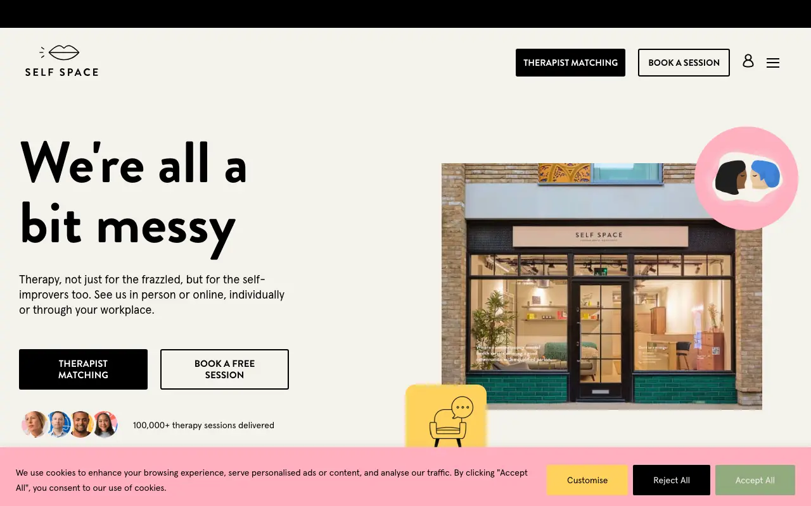

# 🔖 Self Space

**Take one thing.** The best opening line in the set, "We're all a bit messy", buried under a
newsletter modal and twelve sections of campaigns.

| Site | Fonts | Colours |
| --- | --- | --- |
| [theselfspace.com](https://theselfspace.com) | Brandon Grotesque 700, Apercu Pro 400–500 | Paper `#F4F2EB`, peach `#FFD9B7`, yellow `#FFD15D`, pink `#FFB0C0`, black ink |

Self Space is a London therapy service with high-street rooms, and its whole pitch is that therapy
is ordinary maintenance, not a crisis. The headline, Brandon Grotesque bold at 92 px, says it in
five words, and the line under it widens the door: "not just for the frazzled, but for the
self-improvers too". Beside it is a photograph of a real shopfront. That one image tells a nervous
visitor more than any portrait could: you can walk in off the street.

The good ideas are about lowering the threshold. A free taster session sits in a full-width band
right under the hero. "No waiting lists", "Personalised matching" and "Whenever, wherever" answer
the three practical worries in plain words. The rooms are shown one by one, with the street and
what it smells like ("You'll smell our incense burning on Golden Square").

Then it undoes itself. On first visit a pink newsletter modal covers the hero and a cookie bar
covers the rest, so the best sentence on the page is behind two overlays. Below the fold there are
fourteen type sizes, two carousels, campaigns, merchandise and a men's-health feature, each in a
different fill. It reads like a brand that's run out of room, not a place to go when you're low.

**Take:** an opening line that normalises going to therapy; showing the real room and the street
it's on; the free first step in its own band. **Leave:** modals on arrival, carousels, and a page
that keeps adding sections.
