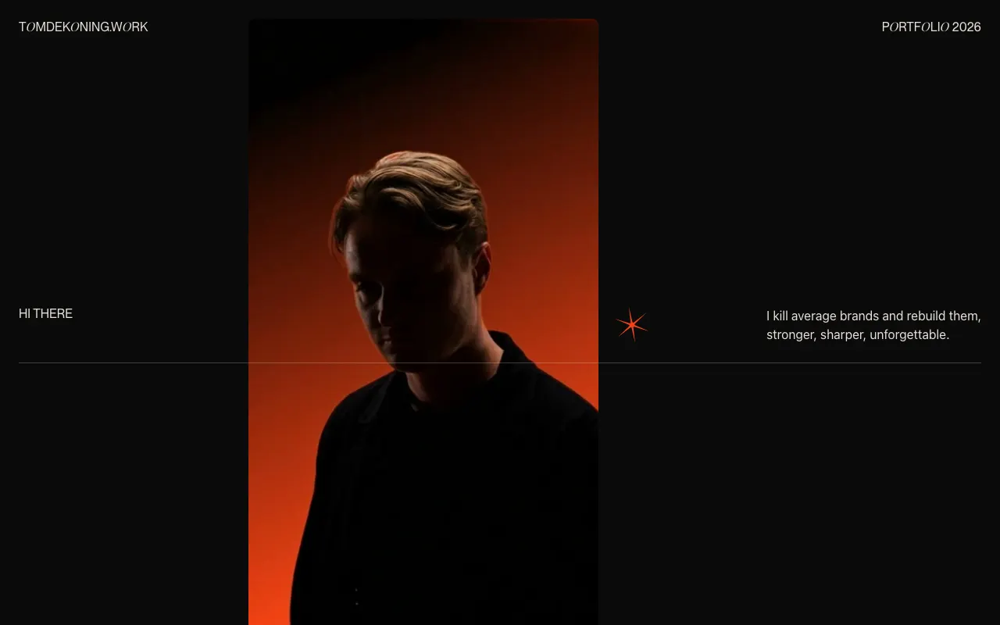

# 🔖 tomdekoning.work

**Take one thing.** A memorable wordmark inside pacing that wastes the reader's time.

| Site | Fonts | Colours |
| --- | --- | --- |
| [tomdekoning.work](https://www.tomdekoning.work/) | PP Neue Montreal, Playfair Display | `#0b0b0b`, cream `#e7e1d7`, orange `#f34213` |

A brand designer selling himself as a brand. There's an orange-lit portrait and the line "I kill
average brands and rebuild them, stronger, sharper, unforgettable." The copy is bravado, and that's
deliberate: the site is the pitch.

The best detail is the wordmark. TOMDEKONING.WORK is set in an upright grotesk (PP Neue Montreal)
with some letters, the O's, swapped for a Playfair italic. It's a cheap trick with a memorable
result: an identity without a logo, made from type alone. It recurs through the site, so the
identity holds together. One orange (`#f34213`) on near-black carries the whole brand.

The pacing is performance art. Long stretches of the page stay empty black until an animation
fires, and the About section has nothing in it until it moves. The huge grey statement, "I build
brands that turn heads", is low contrast on black. Client work is shown bent onto a curved WebGL
screen, which makes the work harder to see in exchange for looking clever. The voice ("what
you're here for (I guess)") is fun once.

**Take:** an identity built by swapping letters between two faces; one accent colour as the entire
brand. **Leave:** sections that are empty until animated; showing work distorted.
