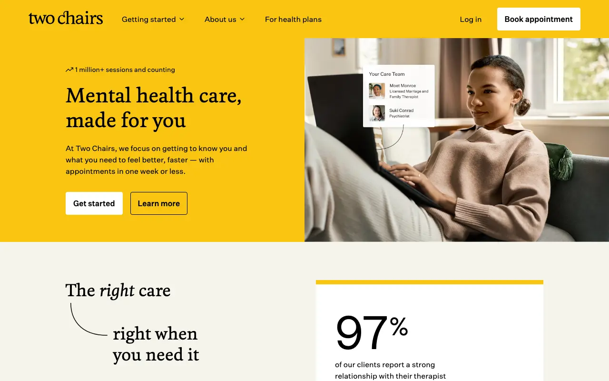

# 🔖 Two Chairs

**Strong reference.** The plainest page in the set, and the one most likely to get an anxious
stranger to book: it talks like a receptionist, not a brand.

| Site | Fonts | Colours |
| --- | --- | --- |
| [twochairs.com](https://www.twochairs.com) | Feijoa 500, Untitled Sans 400 | White and cream `#F6F4EC`, yellow `#F9C511`, navy `#323D54` footer, black ink |

Two Chairs is a large US therapy provider, and its home page is written for someone who doesn't yet
know what they need. The first screen says what it is ("Mental health care, made for you"), what
happens next ("appointments in one week or less") and gives one action, "Get started", with "Book
appointment" pinned in the top bar. The next section answers the fear behind the click: "even if
you're not sure what you need yet". That sentence does more work than any image on the page.

The craft is in how little it asks. Headings are Feijoa, a soft serif, at 40 px and no bigger; body
text is Untitled Sans at 16 px, and the page uses ten sizes but leans on two. Yellow is spent as
whole fields, the hero and the closing call, never as decoration, so it reads as warmth rather than
alarm. Clinicians appear as small cards with a face, "Fully licensed" and three topics each, which
is how a person actually chooses a therapist. Testimonials carry a first name and a topic tag, and
the footer prints a crisis line. At 390 px the hero stacks to headline, sentence and both buttons
inside the first screen.

What fails is the marketing layer bolted on top: a 97 % stat in a box, a looping hand-drawn line
behind the testimonials, a stock photo of a woman on a laptop with a fake "Your Care Team" card
floating over it. Those are startup habits, and a solo clinician can't fake the scale they imply.

**Take:** the first screen as what, when and one action; the "not sure what you need" reassurance;
therapists as face, licence and topics; a crisis line in the footer. **Leave:** stat boxes,
decorative squiggles and stock-photo product mockups.
