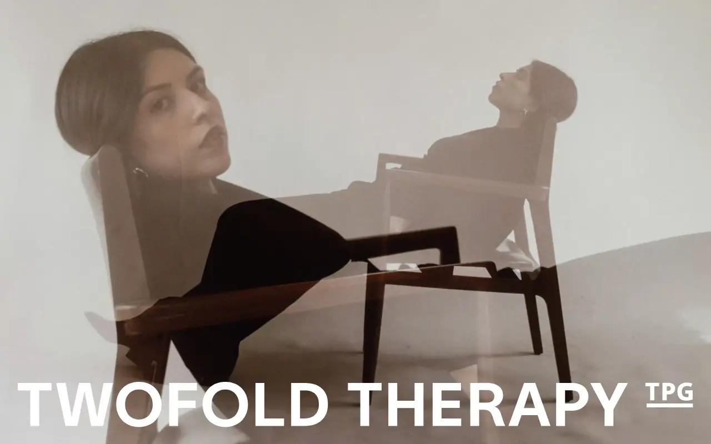

# 🔖 Twofold Therapy

**Take one thing.** The services list is a model; the art-directed photography is for the jury,
not for someone looking for help.

| Site | Fonts | Colours |
| --- | --- | --- |
| [twofoldny.com](https://twofoldny.com) | GT America Standard, GT Super Text | White, black ink, greys `#D4D4D2` |

Twofold (Awwwards honourable mention, 2026) is a psychoanalytic practice in New York led by one
clinician. The page opens on a full-bleed double exposure of a woman in a chair with the name in
white over it, then turns into a strict grid: a small label column on the left and prose on the
right. It uses three type sizes and no colour at all.

The services section is the part worth studying. Four rows, each with a name in GT Super ("Couples
therapy") and one sentence beside it in the sans ("A calm space to slow recurring cycles, improve
communication, and rebuild connection"). Above them, one paragraph describes intake: "Intake begins
with a consultation designed to understand what is happening now… a chance to slow down, clarify
goals, and get a sense of whether the fit feels right." That paragraph answers the question most
first-timers have and most sites skip, which is what actually happens in the first session.

The rest is affectation. There is no heading on the first screen, only a wordmark on a photograph,
and the double exposures of a woman twisting in a chair read as unease. They're a striking
editorial idea, but for a visitor who is already anxious they set the wrong tone. The 01–04
numbers on the rows carry no information. Body text drops to 13 px on a phone, and there is no
booking action until the contact page.

**Take:** services as name plus one sentence; a paragraph on what the first consultation is for.
**Leave:** ambiguous art photography as the opening, and row numbers that count nothing.
