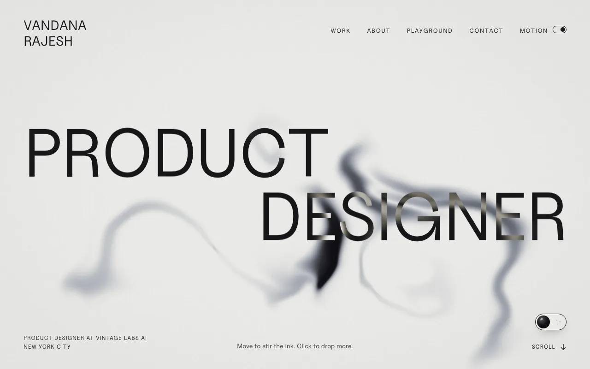

# 🔖 vandanar.design

**Take one thing.** Its case pages: a facts row, a stated result, and an honest note about the data
in the screenshots.

| Site | Fonts | Colours |
| --- | --- | --- |
| [vandanar.design](https://vandanar.design/) | Uncut Sans | Grey paper `#e9e9e6`, ink `#111111` and `#2a2a27` |

The front page is a 147 px "PRODUCT DESIGNER" in ink smoke you can stir with the pointer, then a
statement that fades in as you scroll, then a sideways reel of selected work with filter pills.
The case page is the opposite of the front: quiet and useful.

That case page is worth copying. Under the title and a one-paragraph lead comes a facts row in
four columns (Role, Company, Year, Services) between hairlines, then a status line: "Live since
October 2026. The redesign is rolling out now." Each project card on the front ends with
"Result: 40% faster shipping". Under the screenshots a line says every screen uses placeholder or
test data. The brief and approach are set as a small caps label on the left and text on the right.

The front page is where it fails. The statement waits on scroll before it can be read, the smoke is
decoration, and the pill filters and pill buttons are the most templated parts of the site. It uses
14 sizes.

**Take:** a facts row and a status line at the top of a case; a stated result per project; saying
when screenshots use test data. **Leave:** text that waits on scroll; pill filters.
